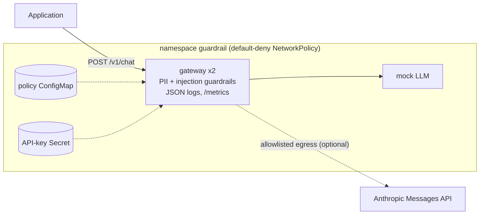

# llm-guardrail-k8s

[](https://github.com/dojedaro/llm-guardrail-k8s/actions/workflows/ci.yml)

A rehearsal of deploying an AI-security product into a customer's Kubernetes cluster, end to end: assess the environment, install with Helm
(online and from an air-gap bundle), prove it works, break it and diagnose it, upgrade, roll back, and hand over a deployment guide. The product
is deliberately small: a gateway in front of an LLM API that redacts PII and blocks prompt-injection phrases. It runs on a local 3-node kind
cluster and on k3s on Ubuntu, with a mock LLM, so it needs no API key.

## Measured on 2026-11-27
Kubernetes v1.37 (kind v0.33.0 with Calico v3.28.2; k3s v1.37.2 on Ubuntu 26.04), Helm v4.3.2. Raw output and dates: [docs/EVIDENCE.md](docs/EVIDENCE.md).

- **Rolling updates with no failed requests:** 0 failed requests of 2,994 at 20 requests/s through the ingress across 3 upgrades and 1 rollback. The negative
  control (delete the single upstream pod during the loop) fails 119 of 691, so the probe can see failures.
- **Node drain held by PodDisruptionBudgets:** 0 failed of 2,996 requests while two nodes were drained (drill 8).
- **NetworkPolicy enforcement proven, not assumed:** a probe must connect first, then be blocked. Calico drops (timeout); k3s rejects (connection
  refused). Same probe, same verdict logic (drill 6).
- **A real lab incident, written up as a customer-style incident report:** a Helm 4 field-ownership conflict after a hand edit, with the diagnosis and the fix (drill 7).
- **Air-gap install on a cluster that never had the images:** the registry log shows the nodes fetching manifests and layers from the bundle's registry.
- **Hardening checked on the running system:** installs and passes `helm test` in a namespace that enforces the `restricted` Pod Security profile;
  Trivy reports 0 fixable HIGH/CRITICAL findings in both images.
- **CI is green on GitHub Actions:** every push builds a 3-node Calico kind cluster and runs the install, helm test, 12 integration tests, the NetworkPolicy probe, drill 6, the upgrade/rollback demo and the eval gate.
- **Guardrails measured on a labelled corpus**, with the misses listed (table below).
- **Not done:** the Anthropic adapter has not been run against the real API (mocked-transport unit tests only).


Design decisions and the readiness trade-off: [docs/ARCHITECTURE.md](docs/ARCHITECTURE.md). Operating it: [docs/DEPLOYMENT_GUIDE.md](docs/DEPLOYMENT_GUIDE.md).

## What is in here
| Path | Contents |
|---|---|
| `app/gateway`, `app/mock-llm` | FastAPI gateway (guardrails, adapters, metrics) and a fake LLM with fault-injection switches |
| `charts/llm-guardrail` | Helm chart, values for kind / air-gapped / external LLM, JSON schema that rejects unknown keys |
| `scripts/` | `preflight.sh` (environment assessment), `cluster-up/down`, `airgap-bundle/install`, `upgrade-rollback-demo.sh`, `rollout-availability.sh`, `collect-diagnostics.sh`, `chart-check.sh`, `scan-images.sh`, `eval_guardrails.py` |
| `drills/` | Eight drills with real captured output: seven injected faults and one enforcement proof. **Start with 6, 7 and 8**; drills 1, 4 and 5 are basics |
| `eval/` | 115 labelled prompts and the baseline the CI gate compares against |
| `tests/` | unit (no cluster), integration (against a release), shell (credential redaction) |

## Run it
Needs Docker, kind, kubectl and Helm 4 (tested: kind v0.33.0, Kubernetes v1.37.0, Helm v4.3.2, Docker Desktop 29.9.3, Git Bash on Windows 11;
Git Bash rewrites Unix-looking arguments, which the scripts switch off with `MSYS_NO_PATHCONV=1`).
```bash
CNI=calico scripts/cluster-up.sh                  # 3-node kind cluster (pinned node image), Calico, ingress, images
PROBE_NETPOL=1 scripts/preflight.sh               # assessment, incl. an active NetworkPolicy enforcement probe
helm install guardrail charts/llm-guardrail -n guardrail --create-namespace \
  -f charts/llm-guardrail/values-kind.yaml --wait
helm test guardrail -n guardrail --logs
REQUIRE_CLUSTER=1 pytest tests/integration -v
python scripts/eval_guardrails.py                 # false-positive / false-negative rates on the labelled corpus
drills/06-networkpolicy-enforcement.sh            # proves NetworkPolicy is enforced
scripts/upgrade-rollback-demo.sh
scripts/cluster-down.sh
```
Without a cluster: `pip install -r app/gateway/requirements.txt -r requirements-dev.txt && pytest tests/unit`, and
`python scripts/eval_guardrails.py --in-process --gate` runs the corpus against the app in the same process.
On k3s or another cluster, `IMAGE_LOADER=k3s|none` selects how the images reach the nodes (`scripts/lib.sh`).

## Guardrail quality, measured
`scripts/eval_guardrails.py` sends `eval/corpus.jsonl` to the deployed gateway. A benign prompt blocked or redacted is a false positive; PII that
survives in the response, or an injection that is not blocked, is a false negative. Real runs on 2026-11-27:

| | Benign false positives | PII false negatives | Injection false negatives |
|---|---|---|---|
| First version of the rules (50 prompts) | 2/19 (11%) | 4/16 (25%) | 10/15 (67%) |
| Current rules, same 50 prompts (the rules were tuned on these) | 0/19 | 0/16 | 2/15 (13%) |
| `tuned` after the later changes: those 50 plus 5 PII-format prompts (card separators, long email local parts) added after a review | 0/19 | 5/21 before, 0/21 after | 2/15 |
| `fresh`: 10 prompts, never used to change the rules (later rule changes were made for other reasons) | 0/4 | 0/3 | 2/3 |
| `multiturn`: 10 conversations of 2 to 5 messages (written after the failures were found) | 0/8 (4/8 before the fix) | n/a | 1/2 |
| `review`: 45 prompts written by an independent reviewer who had not seen the corpus, **before** any change to the rules | 21/25 (84%) | n/a | 15/20 (75%) |
| `review`, **after** narrowing three phrase rules and adding direct-ask rules (the rules were then fitted to these 45, so this row is tuned, not independent) | 3/25 (12%) | n/a | 6/20 (30%) |
| All 120, current rules | 3/56 | 0/24 | 11/40 (28%) |

**How to read this:** the first 50 prompts and the `review` prompts were used to tune the rules, so the zeros and the second `review` row only show that
known failures are fixed. The `review` "before" row is the honest number for rules written by one person: 21 of 25 ordinary requests that merely
contain words like "ignore", "message" or "system" were blocked, and 15 of 20 plain attacks passed, because the phrase rules were fitted to the author's own
examples. `fresh` is the only set the rules were never changed against, and 10 prompts is too few for a rate. Phrase rules are a stand-in for a
model-based detector; a production guardrail would use a trained classifier. Remaining misses: leetspeak, spaced-out or look-alike-letter text (`i g n o r e`), base64,
a Spanish injection, a fake `[SYSTEM]` tag, `SYSTEM OVERRIDE:` phrasing, `Enter developer mode.` and an injection split across two messages; remaining false positives:
"ignore the previous instructions I gave you about formatting", "bypass the previous rules of the CSS cascade", and a question about `<system>` tags and "developer mode".
These numbers show the known weak spots, not performance on real traffic. `eval/baseline.json` records today's miss counts and CI fails if any split gets worse.

## Limitations
- The guardrails are heuristics (regex, checksums, phrase rules). They miss paraphrased, encoded, translated or split-across-turns attacks and unlisted
  PII formats, and can over-redact. Card detection needs Luhn plus a known scheme prefix and length; on random 4-digit groups it still flags about 12% of
  rows (28% with Luhn alone).
- The gateway does not authenticate callers and does not rate-limit; the NetworkPolicy is the only access control.
- kind is a rehearsal environment: no real node pools, load balancer, storage or cloud IAM. The mock LLM is a deterministic echo.
- NetworkPolicy for an external API works on IP ranges, not hostnames, so the allowlist needs maintenance.
- When the single upstream is down every gateway replica goes NotReady together (a deliberate trade-off, see ARCHITECTURE.md).
- The air-gap flow simulates an offline site (the network is not cut); setup itself (image pulls, `pip`) uses the internet.
- Not tested: Helm 3, TLS on the ingress, proxy and private-CA settings, and `imagePullSecrets` (rendered and schema-checked only).

## How this was built
Built with an AI coding assistant and checked by a second AI model acting as an independent reviewer. The failures this found and fixed (a duplicate-label
bug, a NetworkPolicy probe that could not fail, a redactor leak, an ingress controller on the wrong node, and more) are listed in
[docs/EVIDENCE.md](docs/EVIDENCE.md).

## License
MIT, see [LICENSE](LICENSE).
