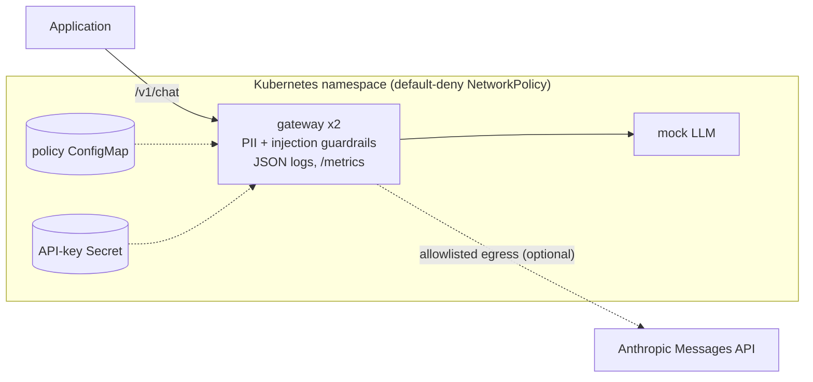

# llm-guardrail-k8s

An LLM guardrail gateway (PII redaction and prompt-injection screening in front of an LLM API), packaged as a Helm chart and
operated the way a field deployment is: environment assessment, online and air-gapped install, integration testing, incident
drills, upgrade and rollback, a support-bundle collector and a customer-facing deployment guide. The point of the repo is the
operations around the service as much as the service itself. It runs on a local kind cluster with a mock LLM, so it needs no API key and no internet.


More detail and design rationale: [docs/ARCHITECTURE.md](docs/ARCHITECTURE.md).

## Field-deployment task -> where it lives
| Task | Where |
|---|---|
| Environment assessment | `scripts/preflight.sh` (PASS/WARN/FAIL report saved to `reports/`) |
| Installation (online) | `charts/llm-guardrail`, [Deployment guide section 4](docs/DEPLOYMENT_GUIDE.md) |
| Installation (air-gapped / on-prem) | `scripts/airgap-bundle.sh`, `scripts/airgap-install.sh`, `values-airgapped.yaml` |
| Integration (apps, external LLM, egress allowlist, secrets) | [Deployment guide section 7](docs/DEPLOYMENT_GUIDE.md), `values-external-llm.yaml`, NetworkPolicy templates |
| Integration testing | `helm test` hook, `tests/integration`, `drills/06-networkpolicy-enforcement.sh` |
| Incident response | `drills/01` to `06` (script + writeup each), `scripts/collect-diagnostics.sh` |
| Upgrade / rollback | `scripts/upgrade-rollback-demo.sh`, policy checksum rollout |
| Documentation | `docs/DEPLOYMENT_GUIDE.md` (customer-facing), `docs/LAB.md` (learning path), `docs/ARCHITECTURE.md` |
| Automation | `scripts/`, `Makefile`, `.github/workflows/ci.yml` |

## Layout
```
app/gateway/        FastAPI gateway (guardrails, adapters, metrics) + Dockerfile
app/mock-llm/       deterministic fake LLM with fault-injection env vars + Dockerfile
charts/llm-guardrail/   Helm chart (+ values-airgapped.yaml, values-external-llm.yaml, values.schema.json)
kind/               3-node cluster configs (default CNI, and Calico variant)
scripts/            preflight, cluster-up/down, build-images, airgap-bundle/install, upgrade-rollback-demo, collect-diagnostics
drills/             six incident drills: <n>.sh injects, <n>.md explains
tests/unit/         pytest, no cluster needed       tests/integration/   pytest against a running release
docs/               DEPLOYMENT_GUIDE.md, LAB.md, ARCHITECTURE.md
```

## Quick start
Prerequisites: Docker, `kind`, `kubectl`, `helm` (Windows install steps: [docs/LAB.md](docs/LAB.md), Exercise 0). Use Git Bash on Windows.
```bash
CNI=calico scripts/cluster-up.sh                # kind cluster + Calico + ingress-nginx + images (omit CNI=calico for kind's default CNI)
scripts/preflight.sh                            # assessment report
helm install guardrail charts/llm-guardrail -n guardrail --create-namespace --wait
helm test guardrail -n guardrail --logs         # smoke tests
pytest tests/integration -v                     # black-box tests (port-forwards by itself)
drills/06-networkpolicy-enforcement.sh          # proves NetworkPolicy is enforced
scripts/upgrade-rollback-demo.sh
scripts/cluster-down.sh
```
Without a cluster you can still run the service tests: `python -m venv .venv`, install `app/gateway/requirements.txt pytest pytest-asyncio`, then `pytest tests/unit`.

## What has actually been verified
Honest status, as of the last commit. "Not yet run" means written and reviewed but never executed against a cluster.

| Item | Status |
|---|---|
| Unit tests (`tests/unit`: guardrails, policy, adapters with mocked HTTP, API behaviour, mock LLM) | **Run: 55 passed** (Python 3.14, local venv) |
| `ruff check` and `ruff format --check` | **Run: clean** |
| `docker build` of both images | **Run: both succeeded** |
| Containers run hardened (`--read-only --cap-drop ALL --user 10001`), gateway reaches mock LLM over a Docker network, `/readyz` OK, PII redacted on input and output, JSON log line without raw PII | **Run: worked** |
| Shell scripts | `bash -n` syntax check **run: clean**; `preflight.sh` run with no cluster: exits with a clear FAIL; the credential `redact()` function and the CPU/memory unit conversions were tested in isolation |
| `helm lint`, `helm template`, kubeconform, values schema | **Not yet run** (helm not installed on the author's machine when this was written) |
| kind cluster, chart install, `helm test`, probes, NetworkPolicies | **Not yet run on a cluster** |
| `tests/integration` | Collected and skip cleanly with no cluster; **not yet run against a cluster** |
| Drills 1 to 6, upgrade/rollback demo, air-gap bundle and install, diagnostics collector | **Not yet run on a cluster**; writeups contain `CAPTURE` placeholders, no output has been invented |
| GitHub Actions workflow | **Not yet run** (repo not pushed); action versions should be re-checked when first pushed |
| Anthropic adapter against the real API | **Not run**; covered only by unit tests with a mocked transport |

## Limitations
- A local kind cluster is a learning and rehearsal environment, not a production multi-tenant cluster: no real node pools, load balancer, storage, or cloud IAM.
- The mock LLM is a deterministic echo, not a model. Latency and quality behaviour of a real LLM are not represented.
- The guardrails are heuristics (regex, checksums, phrase rules). They will miss paraphrased, encoded, translated or multi-turn attacks and unlisted PII formats, and they can over-redact. This is not a complete security control.
- NetworkPolicy to an external API works on IP ranges, not hostnames; the allowlist needs maintenance.
- Whether kind's default CNI enforces NetworkPolicy depends on the kindnet version. That is why a Calico option and an enforcement drill are included instead of an assumption.
- The air-gap flow simulates an offline site (bundle, checksum, private registry, values override); the network is not physically isolated.

## License
MIT, see [LICENSE](LICENSE).
