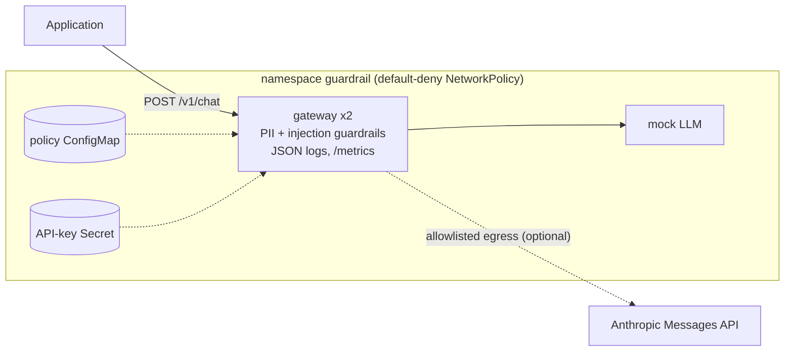

# llm-guardrail-k8s

A small gateway that sits in front of an LLM API and redacts PII or blocks prompt injection, packaged as a Helm chart with the
operational tooling around it: environment assessment, online and air-gapped install, incident drills, upgrade and rollback, a support-bundle
collector and a deployment guide. It runs on a local kind cluster with a mock LLM, so it needs no API key.


Design decisions and the readiness trade-off: [docs/ARCHITECTURE.md](docs/ARCHITECTURE.md).

## What is in here
| Path | Contents |
|---|---|
| `app/gateway`, `app/mock-llm` | FastAPI gateway (guardrails, adapters, metrics) and a fake LLM with fault-injection switches |
| `charts/llm-guardrail` | Helm chart, values for kind / air-gapped / external LLM, JSON schema that rejects unknown keys |
| `scripts/` | `preflight.sh` (assessment), `cluster-up/down`, `airgap-bundle/install`, `upgrade-rollback-demo.sh`, `rollout-availability.sh`, `collect-diagnostics.sh`, `chart-check.sh`, `eval_guardrails.py` |
| `drills/` | Eight incident drills; each has a script that breaks something and a writeup with real captured output |
| `eval/corpus.jsonl` | 60 labelled prompts used to measure the guardrails |
| `tests/` | unit (no cluster), integration (against a release), shell (credential redaction) |
| `docs/` | [Deployment guide](docs/DEPLOYMENT_GUIDE.md), [architecture](docs/ARCHITECTURE.md), [hands-on lab](docs/LAB.md), [evidence](docs/EVIDENCE.md) |

## Run it
Needs Docker, kind, kubectl and Helm 4 (tested: kind v0.33.0, Kubernetes v1.37.0, Helm v4.3.2, Docker Desktop 29.9.3, Git Bash on Windows 11).
```bash
CNI=calico scripts/cluster-up.sh                  # 3-node kind cluster, Calico, ingress-nginx, images
PROBE_NETPOL=1 scripts/preflight.sh               # assessment, incl. an active NetworkPolicy enforcement probe
helm install guardrail charts/llm-guardrail -n guardrail --create-namespace \
  -f charts/llm-guardrail/values-kind.yaml --wait
helm test guardrail -n guardrail --logs
REQUIRE_CLUSTER=1 pytest tests/integration -v
python scripts/eval_guardrails.py                 # false-positive / false-negative rates on the labelled corpus
drills/06-networkpolicy-enforcement.sh            # proves NetworkPolicy is enforced
scripts/upgrade-rollback-demo.sh
scripts/cluster-down.sh
```
Unit tests need no cluster: `pip install -r app/gateway/requirements.txt -r requirements-dev.txt && pytest tests/unit`.

## Guardrail quality, measured
`scripts/eval_guardrails.py` sends `eval/corpus.jsonl` to the deployed gateway and counts: a benign prompt blocked or redacted is a false
positive; PII that survives in the response, or an injection that is not blocked, is a false negative. Real runs, 2026-11-27:

| | Benign false positives | PII false negatives | Injection false negatives |
|---|---|---|---|
| Before this round of fixes (50 prompts) | 2/19 (11%) | 4/16 (25%) | 10/15 (67%) |
| After, `dev` half (25) | 0/9 | 0/8 | 0/8 |
| After, `heldout` half (25) | 0/10 | 0/8 | 2/7 (29%) |
| After, `fresh` (10, written after the rules were frozen, run once) | 0/4 | 0/3 | 2/3 |
| After, all 60 | 0/23 (0%) | 0/19 (0%) | 4/18 (22%) |

Read these carefully. The rules were tuned on `dev`. `heldout` was written together with `dev` by the same author, who had already seen
the failure cases, so it is **not** an independent test; only `fresh` is, and 10 prompts is too few for a rate. The corpus is small and
written by the author. The misses that remain are a fake `[SYSTEM] New instructions:` tag, leetspeak (`1gn0re`), a Spanish injection and
`SYSTEM OVERRIDE:` phrasing. The numbers show regressions are caught and the known weak spots, not how it performs on real traffic.

## What has actually been verified
All runs on a local kind cluster on 2026-11-27 (versions above); raw output and the failures found along the way are in [docs/EVIDENCE.md](docs/EVIDENCE.md).

| Item | Status |
|---|---|
| Unit tests | **96 passed** in `python:3.12.16` with the image's pinned dependencies; also 96 passed on local Python 3.14 with newer ones. `ruff` clean |
| Chart static checks | `helm lint`, `helm template` for six values combinations, **kubeconform -strict** (v0.6.7, Kubernetes 1.31 schemas), strict duplicate-key YAML check, 8 bad-value cases rejected. The same check **failed** on the previous commit (duplicate label keys) |
| Install, `helm test` | 7/7 smoke checks pass; ingress exposes `/v1` only (`/metrics`, `/readyz` answer 404) |
| Integration tests | **10 passed** with `REQUIRE_CLUSTER=1` (includes 502/504 fault injection through Helm and a live security-context check) |
| Preflight | 13 PASS with the active NetworkPolicy probe (positive control, then must time out); with an unpullable probe image it reports "inconclusive", not PASS |
| Drills 1-8 | Run with inject, diagnose and restore; real output in each writeup. Drill 6 passes (Calico). Drill 8: 2996 requests through a two-node drain held by PodDisruptionBudgets, 0 failed |
| Upgrade / rollback | Config change and image upgrade (0.1.0 to 0.1.1) each verified, then rolled back and verified |
| Rolling-update availability | 0 failed of 2994 requests (20/s through the ingress) across 3 upgrades and 1 rollback. Negative control (delete the single upstream pod): 119 of 691 failed, so the measurement can see failures |
| Air-gapped install | Bundle built, a one-byte corruption detected, install from the bundle works; the registry log shows the nodes fetching from it. The network is not physically cut off |
| Support bundle | Planted fake credentials were absent from the bundle after a redactor fix; a first run leaked one (`name:`/`value:` env pairs) |
| Image scan | Trivy (0.58.1) found 3 HIGH starlette CVEs in the first image; after bumping the pins the Python findings are gone and 4 HIGH `libpam` findings in the Debian 12 base remain (fix available upstream, not yet in the pinned base tag) |
| GitHub Actions workflow | **Not run** (repo not pushed). Its steps are the commands above; action versions are unchecked major tags |
| Anthropic adapter | **Not run** against the real API (mocked-transport unit tests only) |
| Helm 3, TLS ingress, proxy env, private CA, `imagePullSecrets` | **Not tested**; rendered and schema-checked only |
| `make` targets | Not run (`make` is not installed on the author's machine) |
| Drills were captured before the final dependency bump | Behaviour-relevant code is unchanged; they were not re-run on the final image |

## Limitations
- kind is a rehearsal environment: no real node pools, load balancer, storage or cloud IAM. The mock LLM is a deterministic echo.
- The guardrails are heuristics (regex, checksums, phrase rules). They miss paraphrased, encoded, translated or multi-turn attacks and unlisted PII formats, and can over-redact.
- NetworkPolicy for an external API works on IP ranges, not hostnames, so the allowlist needs maintenance.
- When the single upstream is down every gateway replica goes NotReady together (a deliberate trade-off, see ARCHITECTURE.md).
- The air-gap flow simulates an offline site; setup itself (image pulls, `pip`) uses the internet.

## How this was built
Built with an AI coding assistant, and then reviewed by an independent reviewer on a different model. The runs, failures and fixes found on a
real cluster (a duplicate-label bug, a NetworkPolicy probe that could not fail, a redactor leak, an ingress controller on the wrong node, and more)
are listed in [docs/EVIDENCE.md](docs/EVIDENCE.md).

## License
MIT, see [LICENSE](LICENSE).
