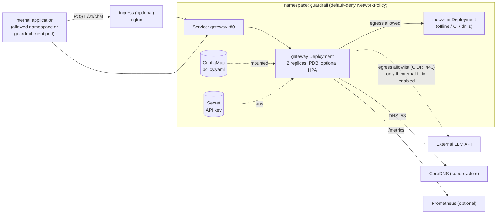

# Architecture

## Request path
1. The caller sends `{"messages": [...]}` to `/v1/chat`. A request id is taken from `X-Request-ID` or generated.
2. **Input guardrails** run on every message: PII detection (email, phone including Korean formats, Luhn-validated card numbers,
   Korean resident registration numbers, API-key-shaped secrets) and prompt-injection heuristics on user messages.
   The policy decides between *redact* (replace with placeholders, continue) and *block* (HTTP 403, upstream never called).
3. The allowed request goes to the upstream through an adapter: the in-cluster mock LLM, or the Anthropic Messages API.
4. **Output guardrail** redacts PII in the reply.
5. The response carries `X-Request-ID` and `X-Policy-Version`; one JSON log line records the decision, rule ids, latency and status (never message content).
6. Upstream failures map to explicit codes: timeout -> 504, refused / error status -> 502, both with the request id.

## Design decisions (and why)
| Decision | Reason |
|---|---|
| `/healthz` checks nothing external; `/readyz` checks policy loaded and upstream reachable | A flaky upstream must remove pods from the Service, not restart them. Restarting does not fix an upstream outage. |
| `maxUnavailable: 0`, `maxSurge: 1` | A bad rollout (wrong image, bad config, missing Secret) leaves the old pods serving. Drills 1, 2, 4 and 5 show this. |
| Policy in a ConfigMap, pod annotation `checksum/policy` | Kubernetes does not restart pods when a mounted ConfigMap changes. The checksum makes `helm upgrade` roll them, so the running policy version always equals the released one. |
| Policy version returned in header and body | Support can tell which policy produced a decision. The upgrade demo verifies it. |
| Default-deny NetworkPolicy plus explicit allows | Gateway ingress only from allowed namespaces; egress only to DNS and the mock LLM (or an allowlisted CIDR). NetworkPolicy matches IPs, not hostnames, hence CIDR config for the external API. |
| Non-root, read-only root filesystem, all capabilities dropped, seccomp RuntimeDefault | Standard hardening; the images need only `/tmp` (an emptyDir). Verified with `docker run --read-only --cap-drop ALL --user 10001`. |
| Secret via `existingSecret` preferred | A key passed through `--set` is stored in Helm release history. |
| Test hook uses the gateway image | No extra image to mirror in an air-gapped site. |
| Mock LLM with fault knobs | Whole stack (and CI) runs without an API key; incident drills can break the upstream on demand. |

## Guardrail limits (deliberately documented)
Regex and checksum heuristics. They miss obfuscated PII (spaced digits, spelled-out numbers), non-listed formats, names and
addresses, paraphrased or encoded or multilingual injection, and multi-turn attacks. Redaction can also over-match.
Treat this as one control among several, not as a complete security boundary.
