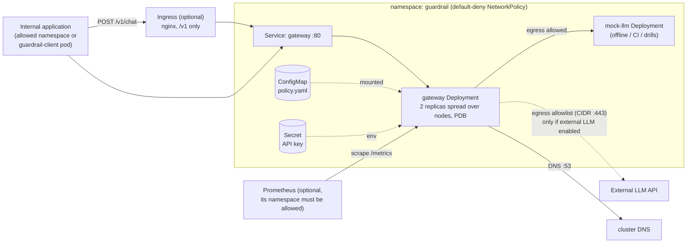

# Architecture

## Request path
1. The caller sends `{"messages": [...]}` to `/v1/chat`. A request id is taken from `X-Request-ID` (only if it is 1-64 characters of
   `A-Za-z0-9._-`, otherwise a fresh one is generated) or generated.
2. **Input guardrails** run on every message of every role (the Anthropic adapter hoists system text into the system prompt, so a caller-supplied
   system or assistant message is as dangerous as a user message): PII detection (email, phone including Korean formats, Luhn-validated card
   numbers, Korean resident registration numbers, API-key/JWT/private-key-shaped secrets) and prompt-injection heuristics, English and Korean. A request is blocked when any one message reaches the injection threshold,
   with each rule counted once per message: scores are never added up across turns, so a long benign conversation about "developer mode" is not blocked
   (and an attack split over several turns is not caught).
   The work runs in a thread pool, so a slow regex cannot stall liveness probes, and the request size is capped (50 messages, 20,000 characters each, 100,000 in total, a 1 MiB body).
   The policy decides between *redact* (replace with placeholders, continue) and *block* (HTTP 403, upstream never called).
3. The allowed request goes to the upstream through an adapter: the in-cluster mock LLM, or the Anthropic Messages API.
   A connection error is retried once (nothing was sent, so it is safe); timeouts are not retried.
4. **Output guardrail** redacts PII in the reply.
5. The response carries `X-Request-ID` and `X-Policy-Version`; one JSON log line records the decision, rule ids, latency and status (never message content).
   Every stdout line is JSON, including validation errors (422) and unexpected errors (500).
6. Upstream failures map to explicit codes: timeout -> 504, connection refused / error status / model refusal -> 502, all with the request id. The response body
   names only the class of failure; the raw exception text stays in the log.
7. A blocked response includes the rule ids that matched. That is deliberate (operators and application teams need it to debug false positives);
   it does let a caller probe which phrases trip the rules, so deployments that treat the callers as untrusted should strip `rules` at the edge.

## Design decisions (and why)
| Decision | Reason |
|---|---|
| `/healthz` checks nothing external; `/readyz` checks policy loaded and upstream reachable | A flaky upstream must remove pods from the Service, not restart them. Restarting does not fix an upstream outage. |
| Readiness includes the upstream (a trade-off, see below) | A bad upstream URL in a new revision must not take traffic and must stall the rollout (drill 2, `url`). |
| `maxUnavailable: 0`, `maxSurge: 1`, preStop sleep, `terminationGracePeriodSeconds` 30 | A bad rollout leaves the old pods serving; the preStop sleep lets endpoint removal propagate before SIGTERM. Measured in EVIDENCE.md. |
| Topology spread (soft) and a PodDisruptionBudget for 2+ replicas | One node drain or failure should not take every replica; the PDB holds the last Ready replica (drill 8). A PDB with one replica would block every drain, so it is not rendered then. |
| Policy in a ConfigMap, pod annotation `checksum/policy` | Kubernetes does not restart pods when a mounted ConfigMap changes. The checksum makes `helm upgrade` roll them, so the running policy always equals the released one. |
| Policy version returned in header and body | Support can tell which policy produced a decision. The upgrade demo verifies it. |
| A broken policy file starts the pod NotReady with a clear log line | Bad YAML or wrong types do not crash-loop the pod; Kubernetes simply withholds traffic and the log says why. |
| Default-deny NetworkPolicy plus explicit allows | Gateway ingress only from allowed namespaces/CIDRs; egress only to DNS and the mock LLM (or an allowlisted CIDR). NetworkPolicy matches IPs, not hostnames, hence CIDR config for the external API. DNS location and hostNetwork ingress controllers are configurable. |
| Non-root, read-only root filesystem, all capabilities dropped, seccomp RuntimeDefault | Standard hardening; the images need only `/tmp` (an emptyDir). Checked on the running pod by an integration test. Satisfies the "restricted" Pod Security profile. |
| Secret via `existingSecret` preferred | A key passed through `--set` is stored in Helm release history. |
| Ingress exposes `/v1` only | `/metrics`, `/readyz`, `/healthz` are for operators; integration test asserts they answer 404 through the ingress. |
| Test hook uses the gateway image | No extra image to mirror in an air-gapped site. |
| Mock LLM with fault knobs | The whole stack (and CI) runs without an API key; incident drills can break the upstream on demand. |

### The readiness trade-off
When the upstream goes away, every gateway replica fails readiness together and the Service has no endpoints: clients get connection errors
instead of fast 502s from a healthy gateway. The alternative (readiness = policy loaded only, upstream health reported separately) keeps pods in
rotation and returns 502/504 itself, but then a rollout with a wrong upstream URL would complete "successfully" and break every request. This
repo chooses the second-order safety (a bad revision cannot go live) over the first (a brief outage looks like 502s), and documents it. With an
external LLM behind an allowlisted egress the upstream check is a cheap reachability request, not a model call. Teams that prefer the other
side of the trade-off would change `/readyz` to check only policy and add a separate `/status` for deep health.

## Guardrail limits (deliberately documented)
Regex and checksum heuristics. They miss obfuscated PII (spaced digits, spelled-out numbers), non-listed formats, names and
addresses, paraphrased or encoded or multilingual injection beyond the Korean phrases covered, and multi-turn attacks. Redaction can also
over-match. Measured rates on a labelled corpus are in the README and `eval/`. Treat this as one control among several, not as a complete security boundary.
